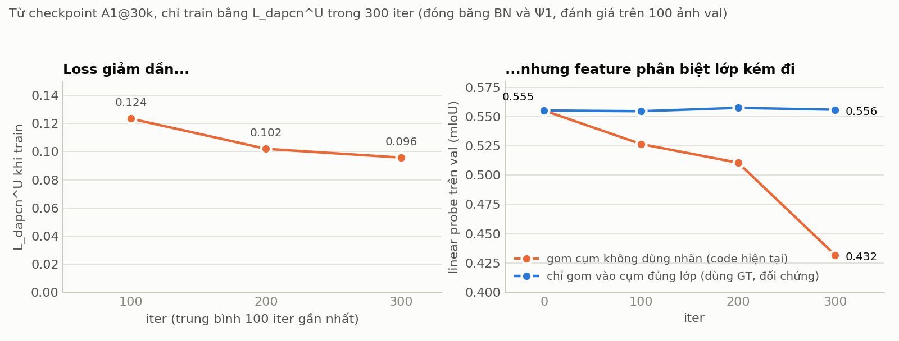
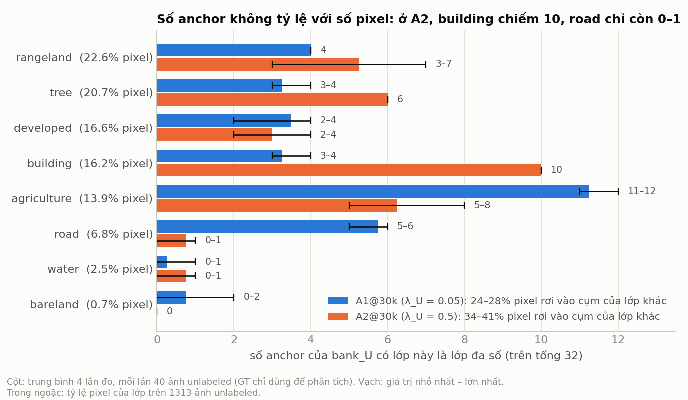
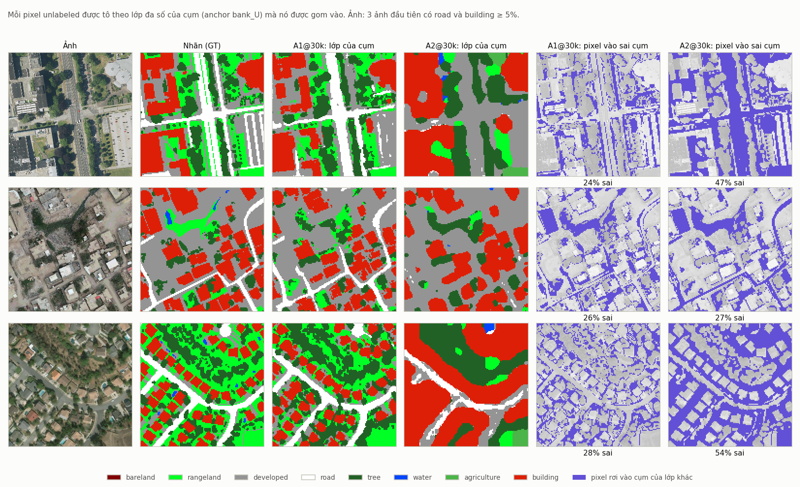

# A1 và A2: tăng trọng số L_dapcn^U làm mô hình kém đi

**Tóm tắt.** Khi tăng trọng số của L_dapcn^U từ 0.05 (A1) lên 0.5 (A2), mIoU giảm khoảng 10 điểm và chênh lệch giữa khu vực seen và unseen tăng gần gấp đôi. Lý do: L_dapcn^U không phải một loss regularize vô hại. Nó gom cụm feature trên ảnh không có nhãn, nên khi trọng số lớn, nó đẩy feature theo hướng ngược với nhãn đúng.

## Thiết lập thí nghiệm

- Dữ liệu: OpenEarthMap, split biased 1/8 (187 ảnh labeled, 1313 ảnh unlabeled), đánh giá trên 2000 ảnh val. Mô hình MiT-B5 + DAFormer, chạy 1 seed.
- Hai run giống hệt nhau, chỉ khác trọng số λ_U của L_dapcn^U: 0.05 ở A1 và 0.5 ở A2.
- Ở cả hai run, bank_L được xây từ nhãn. Optimizer thứ hai (cho L_sup2, L_con1, L_con2) chỉ cập nhật nhánh P2, không động vào backbone và head.
- Kỳ vọng ban đầu: L_dapcn^U giúp giảm overfit trên 187 ảnh labeled, nên A2 ít nhất phải bằng A1.

## Kết quả

| | A1 (λ_U = 0.05) | A2 (λ_U = 0.5) |
|---|---|---|
| mIoU trên val tại 12k (%) | 61.2 | 51.6 |
| mIoU seen / unseen tại 12k (%) | 62.6 / 56.8 | 54.3 / 43.6 |
| Chênh lệch seen − unseen (điểm) | 5.8 | 10.7 |
| mIoU từ 14k đến 30k (%) | 59.8–61.7, ổn định | 40.1–54.0, lên xuống thất thường |

- Chênh lệch seen − unseen tăng thêm 4.9 điểm (khoảng tin cậy 95%: 1.0–8.6).
- Lúc đầu A2 gần bằng A1, nhưng càng train càng tụt. A2 thua A1 lần lượt 1.7 / 0.3 / 2.1 / 3.8 / 8.2 / 9.6 điểm tại 2k / 4k / 6k / 8k / 10k / 12k iter.

## Nguyên nhân

### 1. L_dapcn^U giảm được mà không cần giữ đúng lớp

L_dapcn^U chỉ yêu cầu hai điều: feature của mỗi pixel nằm sát anchor của cluster mình, và các center anchor nằm cách xa nhau. Trên ảnh unlabeled, pixel được chia vào cluster theo độ giống của feature. Một pixel road có feature giống building sẽ vào cụm building. Loss của pixel đó có cao hơn một chút, dẫn đến muốn loss giảm phải kéo feature đó vào gần anchor building, tức là sâu hơn vào cluster sai, vì loss không biết class đúng là road. CE thì khác: CE có nhãn nên kéo pixel về đúng class.

Số liệu (40 ảnh unlabeled, dùng GT để kiểm tra): ở A1, pixel nằm trong cụm của class khác có loss trung bình 0.132, pixel đúng cụm là 0.074. Ở A2, tỷ lệ pixel sai cụm tăng từ 28% lên 39%, nhưng loss của các pixel này lại giảm còn 0.041, thấp hơn cả pixel đúng cụm ở A1. Tức là loss giảm bằng cách kéo pixel sâu hơn vào cụm sai, chứ không phải đưa pixel về đúng class.

Thí nghiệm kiểm chứng (Hình 1): bắt đầu từ checkpoint A1@30k, chỉ train bằng L_dapcn^U trong 300 iter, đóng băng BN và Ψ1 (lớp phân loại cuối).

Vì sao chỉ dùng L_dapcn^U: trong training thật, CE, L_con và thống kê BN thay đổi cùng lúc, nên so A1 với A2 không tách được tác động riêng của loss này. Bỏ các loss khác và đóng băng BN thì mọi thay đổi của feature đều do L_dapcn^U gây ra. 300 iter × 4 ảnh ≈ 1 lượt qua 1313 ảnh unlabeled, đủ để thấy xu hướng; learning rate đặt bằng mức của training tại iter 30k.

- Loss giảm dần: trung bình 0.124 ở 100 iter đầu, 0.096 ở 100 iter cuối.
- Nhưng feature phân biệt lớp kém đi: linear probe trên val giảm từ 0.555 xuống 0.432. Linear probe: giữ nguyên feature của mô hình, huấn luyện lại từ đầu một lớp phân loại tuyến tính (256 → 8 class, cùng dạng với Ψ1) trên một nửa số ảnh val, rồi đo mIoU trên nửa còn lại. mIoU càng cao thì feature càng chứa nhiều thông tin class. Dùng probe thay cho mIoU của mô hình vì Ψ1 bị đóng băng: feature dịch chuyển thì Ψ1 cũ đoán sai, dù feature có thể vẫn tách class tốt.
- Đối chứng: vẫn loss đó, nhưng chỉ cho mỗi pixel vào cụm đúng lớp của nó (dùng GT, chỉ để kiểm tra). Linear probe giữ nguyên 0.556.

Như vậy, vấn đề nằm ở việc gom cụm không có nhãn, chứ không phải ở việc kéo feature lại gần nhau.

### 2. Nhiều pixel bị gom vào cụm của lớp khác

Kiểm tra bằng GT của ảnh unlabeled (chỉ dùng để phân tích; đo 4 lần, mỗi lần 40 ảnh):

- Tỷ lệ pixel rơi vào cụm của lớp khác: 24–28% ở A1, 34–41% ở A2 (A2@28k: 45%, đo 1 lần).
- Số anchor của mỗi lớp không tỷ lệ với số pixel của lớp đó (Hình 2). Ở A2, building chiếm 10/32 anchor dù chỉ có 16% pixel; road từ 5–6 anchor ở A1 chỉ còn 0–1.
- Trên ảnh (Hình 3), các cụm ở A2 thành những mảng lớn, mất chi tiết: đường bị gom vào cụm developed, nhà và vùng xung quanh bị gom chung vào cụm building.

### 4. Feature bị hỏng

Trên 200 ảnh val, linear probe giảm từ 0.54 (A1) xuống 0.46–0.52 (A2), và số chiều hiệu dụng của feature giảm từ 6.0 xuống 3.4–4.5. Ngoài ra, ở A2 thống kê BN giữa ảnh labeled và unlabeled lệch nhau 0.19–0.44σ (A1 chỉ 0.03σ), khiến mIoU val của A2 lên xuống thất thường.

Code đã được kiểm tra: giá trị loss tính tay khớp với code (0.2193), không có lỗi cài đặt.

## Kết luận

- Giả thuyết "L_dapcn^U giúp chống overfit" không đúng. Loss này không cung cấp thêm thông tin về lớp, chỉ ép feature thành các cụm. Khi trọng số lớn, nó lấn át tín hiệu từ nhãn.
- Khu vực unseen bị ảnh hưởng nặng nhất, mà đây lại chính là vùng ta muốn dùng dữ liệu unlabeled để bù.
- Với λ_U = 0.05, loss này gần như không gây hại, nhưng cũng chưa rõ có giúp gì không vì chưa có run λ_U = 0.

## Hạn chế

- Chỉ chạy 1 seed. Các phân tích dùng 100–200 ảnh val và 10 batch unlabeled.
- Số anchor của từng lớp thay đổi giữa các lần đo (xem vạch trên Hình 2). Bareland chỉ có 0.7% pixel nên không đủ để kết luận.
- Thí nghiệm ở mục 1 không có CE nên feature hỏng nhanh hơn so với khi train thật. Bản đối chứng còn dùng anchor của bank_L, nên chưa tách riêng được hai yếu tố.

## Bước tiếp theo

- Giữ λ_U = 0.05.
- Chạy B1/B2: cho L_sup2, L_con1, L_con2 cập nhật cả backbone và head, để xem thông tin lớp từ bank_L có giúp khu vực unseen không.
- Nếu cần biết L_dapcn^U có ích hay không, chạy thêm một run với λ_U = 0.
